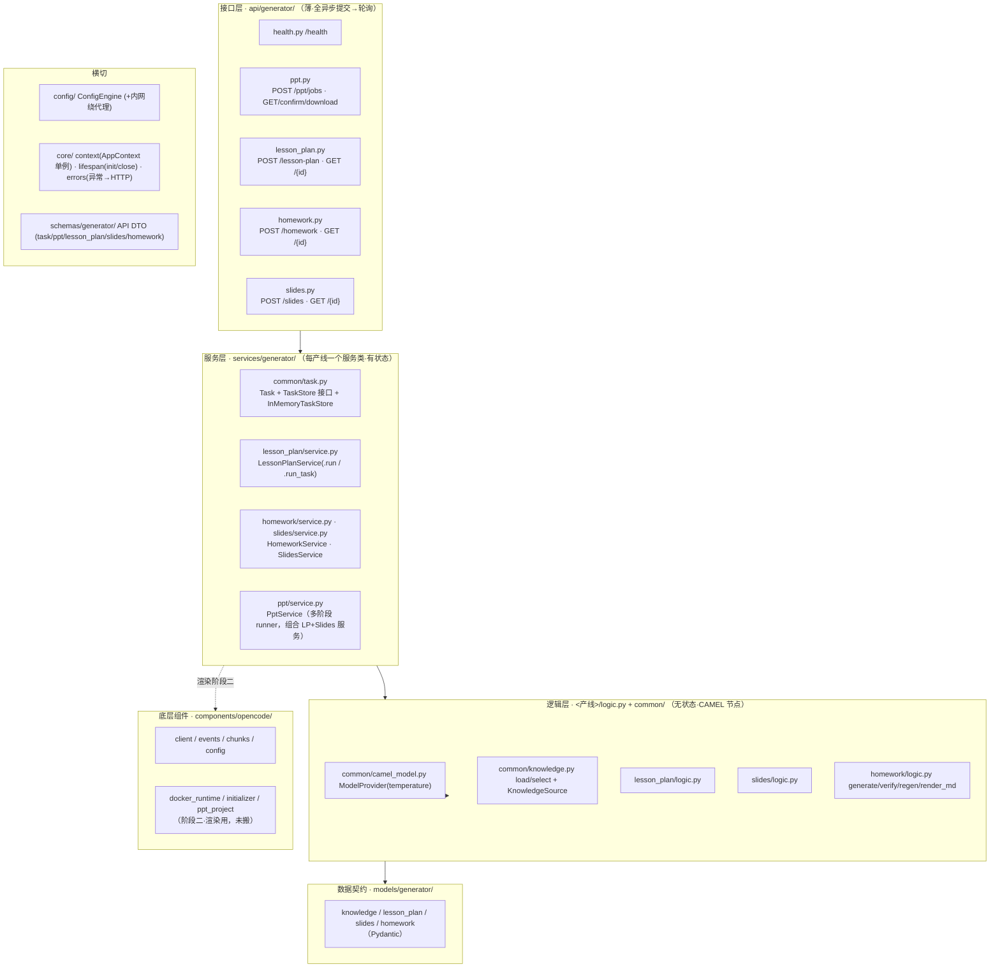
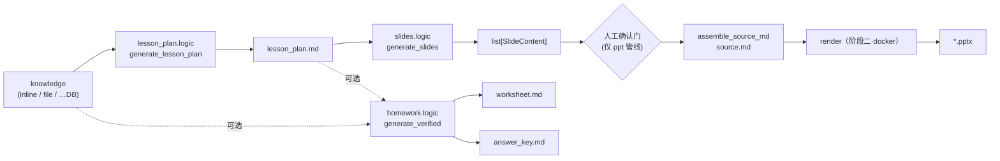
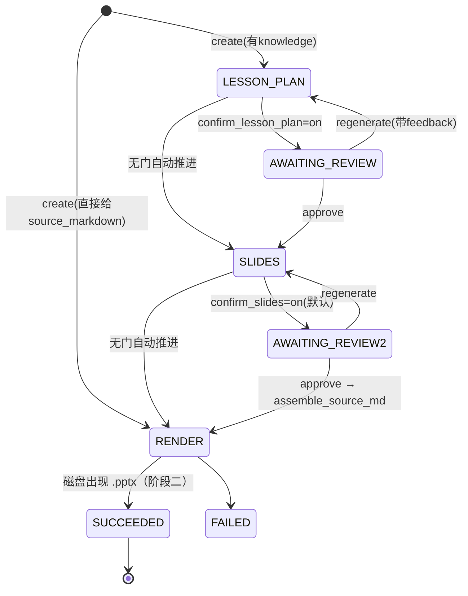

# 内容生成服务 · 架构文档

> 用 FastAPI 把「知识点 → 教案 / 作业 / PPT」三条产线包成 HTTP 服务。
> 参考实现在 `SHOU_Project/opencode_ppt/ocppt_app`（只作参考，不照搬）。
>
> 本文描述**当前已实现的架构（as-built）**。内容管线（教案/作业/slides + API + 任务态 + 错误处理）
> 已连真实模型验收通过；PPT 渲染（source.md → pptx，依赖 docker）为阶段二，暂留桩。

---

## 0. 已锁定的决策

| #  | 决策点            | 结论                                                                                                                                                             |
| -- | ----------------- | -------------------------------------------------------------------------------------------------------------------------------------------------------------- |
| 1  | 内部枚举语言      | **全英文键**（`choice/fill_blank/subjective`、`basic/advanced/challenge`、`new_teach/review_comprehensive/unit_summary`）；prompt 要求模型输出英文键；给人看的 md 用 `TYPE_ZH`/`DIFF_ZH` 转中文 |
| 2  | 教案/PPT/作业拓扑 | **分布为底 + 整合为薄编排**：每环节是独立自洽节点各出端点；PPT 全管线是薄状态机，只**组合调用**这些节点                                                          |
| 3  | 配置              | **收敛到 `ConfigEngine` 一套**：全项目走 `config_engine.base_config.xxx`；`Settings` 只作 env 读取源喂它                                                          |
| 4  | 代码组织          | **按产线切（feature-first）+ 每产线一个 Service 类**：`services/generator/<产线>/{logic.py, service.py}`；`service.py` = 一个服务类（`.run` + `.run_task`），依赖从**全局 `AppContext` 单例**取（`self.context = context or AppContext()`），`PptService` 组合其它服务；共享进 `common/`；`models/schemas/api` 按层 |
| 5  | 任务态            | **统一任务运行时**：四条产线全是 `Task`（`common/task.py`）；单阶段产线（教案/作业/slides）+ 多阶段产线（ppt）跑在同一 `TaskStore` 上                             |
| 6  | 交互模式          | **全异步：提交→轮询**。每产线自己的端点：`POST /xxx`→`202 TaskRef`，`GET /xxx/{id}`→`TaskDetail`（不留同步入口，不用统一 `/tasks`）                                |
| 7  | 会变的边界        | `KnowledgeSource`（换 DB/云）、`TaskStore`（换 Redis）都是**接口**，本版最简实现，经 `dependencies.py` 注入，替换不动上层                                          |
| 8  | 本版范围          | **内容管线全做**；**PPT 渲染（docker）留阶段二**                                                                                                                  |

---

## 1. 宏观架构（分层）



**分层职责边界（铁律）**

- **api**：只做 HTTP 编解码 + `Depends` 注入服务/取任务。不写业务逻辑。
- **services**：**每产线一个服务类**（依赖 provider/source 构造注入）。`run` 纯用例 + `run_task` runner（管任务态与异常兜底）；**调 logic 节点，不自己调 CAMEL**。`PptService` 组合其它服务。
- **logic**：无状态纯函数，`输入契约 → 输出契约`，内部调 CAMEL agent。可脱离 FastAPI 单测。
- **models**：纯数据契约（Pydantic / dataclass），**无行为、无 IO**。
- **components**：底层 IO（opencode 客户端；阶段二 docker 运行时）。
- **config / core / schemas**：横切设施。

---

## 2. 微观：三条产线的数据流与契约



**契约要点**

- 三条产线共享 `common/knowledge`（`load_knowledge` / `select_points` / `resolve_knowledge`）+ `common/camel_model`（`ModelProvider`）。
- **教案**：`LessonPlanRequest → LessonPlanResponse(lesson_plan_md)`。独立端点，也是 PPT 管线第 1 步。
- **slides**：`lesson_plan_md → list[SlideContent]`，再 `assemble_source_md` 成一页一节的 `source.md`（为阶段二锁死「一节一页不重排」）。
- **作业**：`HomeworkRequest → HomeworkResponse`，含 `generate → L1/L2 校验 → 重生成闭环`；输出结构化题目 + `worksheet.md` + `answer_key.md`。可选吃 `lesson_plan_md`。
- **注**：教案/slides/作业各自也可作为**独立异步任务**直接调用（不必走 ppt 管线）。

---

## 3. 通用任务运行时（所有产线共用）

`common/task.py` 是产品无关的任务基建：

```
Task            task_id · kind · request · status · stage
                · context(runner 中间态) · result(最终产物) · review(确认门产物) · error · 时间戳
TaskStore(ABC)  create / get / list(kind?) / update / delete / spawn
InMemoryTaskStore   进程内 dict + asyncio.create_task（+ wait_all 供测试/优雅关停）
```

- **单阶段产线**（教案/作业/slides）：runner = 服务类的 `run_task` 方法，跑完把产物放 `result`、状态置 `SUCCEEDED`；出错落 `error` + `FAILED`。
- **多阶段产线**（ppt）：runner = `PptService`（状态机），用 `context` 存中间态（`lesson_plan_md`/`slides`/`source_markdown`）、`review` 给确认门、`stage` 记当前阶段。
- API 交互：`POST` 建任务 + `store.spawn(runner)` 后台推进 → 立即返回 `TaskRef`；`GET /{id}` 轮询取 `TaskDetail`（`SUCCEEDED` 时带 `result`）。
- 各产线返回自己的 `TaskDetail` 子类（`result` 类型不同），公共字段来自 `TaskDetailBase` + `base_detail_fields()`。

---

## 4. PPT 全管线状态机（多阶段 runner）



- 确认门 = `status=AWAITING_REVIEW` + `review` 产物 + `POST /ppt/confirm/{id}` 推进（opencode 无确认事件，确认必须在编排层做）。
- `PptService` 每个阶段方法**只调用被组合的产线服务**（`self._lesson_plan.run` / `self._slides.run` / `assemble_source_md`），中间态存 `task.context`，自身只管状态流转与异常兜底。
- **本版**：`RENDER` 阶段留桩——组装好 `source_markdown` 后标 `FAILED` 并说明（内容产物齐全，接 docker 即成），阶段二替换。

---

## 5. 模块布局（as-built file tree）

> **组织范式 = 按产线切（feature-first）**：每条产线是 `services/generator/<line>/` 下自包含包，
> `logic.py`（无状态节点）+ `service.py`（**一个服务类**：`.run` 纯用例 + `.run_task` runner）；共享进 `common/`。
> 数据契约 `models/`、API DTO `schemas/`、路由 `api/` 按层独立。

```
app/
  main.py                        # app + lifespan + include 聚合路由 + register_exception_handlers
  dependencies.py                # 薄工厂：get_*_service（→Service()）/ get_task_store（→AppContext().task_store）
  utils/
    common.py                    # SingletonMeta（单例元类）
  config/
    settings.py                  # env 读取 + _bypass_proxy_for（内网出站自动绕全局代理）
    cfg.py                       # ConfigEngine（唯一配置真相）
  core/
    context.py                   # AppContext 单例：config/model_provider/knowledge_source/task_store(+预留 redis)
    lifespan.py                  # 启动 AppContext().initialize()，关停 close()
    errors.py                    # register_exception_handlers（领域异常 + openai → HTTP JSON）
  models/generator/              # 数据契约（纯 Pydantic/dataclass）
    knowledge.py lesson_plan.py slides.py homework.py
  services/generator/
    common/
      task.py                    # Task + TaskStore 接口 + InMemoryTaskStore + base_detail_fields
      camel_model.py             # ModelProvider.get(temperature)
      knowledge.py               # load/select + KnowledgeSource(fetch) + resolve_knowledge
      errors.py                  # GenerationError / KnowledgeError / ParseError / ModelError
    lesson_plan/
      logic.py                   # PROMPT + build_request + generate_lesson_plan（无状态节点）
      service.py                 # class LessonPlanService(.run / .run_task)
    slides/
      logic.py                   # PROMPT + generate_slides + assemble_source_md
      service.py                 # class SlidesService(.run / .run_task)
    homework/
      logic.py                   # PROMPT + generate/verify/regenerate/render_md（中文标签映射）
      service.py                 # class HomeworkService(.run / .run_task)
    ppt/
      service.py                 # class PptService（多阶段 runner；组合 LP+Slides 服务；渲染留桩）
  schemas/generator/
    task.py                      # TaskStatus / TaskRef / TaskDetailBase（通用契约）
    lesson_plan.py               # GenRequest + Result + LessonPlanTaskDetail
    slides.py                    # GenRequest + Result + SlidesTaskDetail
    homework.py                  # GenRequest + Result + HomeworkTaskDetail
    ppt.py                       # CreateJobRequest / ConfirmRequest / PptStage / ReviewArtifact / PptTaskDetail
  api/generator/
    __init__.py                  # 聚合 router
    health.py lesson_plan.py slides.py homework.py ppt.py
  components/opencode/           # client / events / chunks / config
    #（阶段二）docker_runtime.py initializer.py ppt_project.py（未搬）
```

**端点一览**

> 统一动词前缀风格：`/<产线>/create`（提交）、`/<产线>/get/{id}`（轮询）。

| 方法+路径                                | 作用                                    |
| ---------------------------------------- | --------------------------------------- |
| `GET /health`                            | 配置就绪 + 模型已装入                    |
| `POST /lesson-plan/create` `GET /lesson-plan/get/{id}` | 教案：提交→轮询           |
| `POST /slides/create` `GET /slides/get/{id}`           | 逐页 slides + source.md   |
| `POST /homework/create` `GET /homework/get/{id}`       | 作业（含 L1/L2 校验闭环）  |
| `POST /ppt/create`                       | PPT 全管线：建任务                       |
| `GET /ppt/list` `GET /ppt/get/{id}`      | 列表 / 查详情（status/stage/review）     |
| `POST /ppt/confirm/{id}`                 | 确认门推进（approve / regenerate）       |
| `GET /ppt/download/{id}`                 | 下载 pptx（阶段二前 409）                |
| `DELETE /ppt/delete/{id}`                | 删除任务                                 |

---

## 6. 关键约定

### 6.0 服务类 + 全局 AppContext
- 每条产线一个服务类：`LessonPlanService` / `SlidesService` / `HomeworkService` / `PptService`。
- **依赖走全局 AppContext**：`__init__(self, context=None): self.context = context or AppContext()`；
  服务用 `self.context.model_provider` / `self.context.knowledge_source`，不再层层传参。
  `dependencies.get_*_service` 工厂只是 `return Service()`（保留 `Depends` 纯为可测性）。
- **两类方法**：`run(...)` 纯用例（返回结果，可复用、可脱离 FastAPI 单测）；
  `run_task(task, store)` runner（管任务态流转 + 异常兜进 `task.error`）。
- **`PptService` 组合其它服务**：`__init__(context=None, *, lesson_plan=None, slides=None)`，
  默认从同一 context 建子服务，阶段方法调 `self._lesson_plan.run` / `self._slides.run`，不重复实现。
- **测试**：服务可选 `context` 参数注入假 context（`SimpleNamespace`），绕过全局单例；
  假子服务是真类子类只 override `run`；API 测试用 `app.dependency_overrides[get_*_service]` 换假服务。
  （注意：`dependency_overrides` 要用零参 lambda `lambda: FakeService()`，不能直接给类——否则 FastAPI 会去解析其 `__init__` 参数。）

### AppContext（全局上下文 · `app/core/context.py`）
- `AppContext(metaclass=SingletonMeta)` 单例，集中持有共享中间件/客户端：
  `config` / `model_provider` / `knowledge_source` / `task_store`（+ 预留 `redis` 等）。
- 生命周期：lifespan 启动调 `initialize()`（幂等构建），关停调 `await close()`。
- 服务里 `self.context = AppContext()` 即可取用；替换了原先「挂 `app.state` + 逐层 `Depends`」的做法。

### 6.1 英文枚举 ↔ 中文展示的边界
- **内部**：`Question.type ∈ {choice, fill_blank, subjective}`；`Difficulty ∈ {basic, advanced, challenge}`；`plan_mode ∈ {new_teach, review_comprehensive, unit_summary}`。
- **prompt**：system prompt 显式规定模型输出英文键（枚举表 + 英文示例 JSON），杜绝解析失败。
- **展示**：`render_worksheet / render_answer_key` 用 `TYPE_ZH` / `DIFF_ZH` 映射表转中文。
- schema 的 `plan_mode` 与 `models/lesson_plan.SessionParams` 一致（均英文 Literal）。

### 6.2 配置（单一真相 = ConfigEngine）
- 只从 `config_engine.base_config.*` 取配置；`Settings` 只是 env 读取源。
- **内网绕代理**：`settings._bypass_proxy_for` 在加载时把模型/opencode 主机并入 `NO_PROXY`，
  避免开发机全局 socks 代理拦截内网端点（表现为 503）。跑 app/脚本都自动生效。

### 6.3 模型注入（AppContext + 保留 temperature）
- `AppContext.initialize()` 建 `ModelProvider`（持 LLM 配置，内部按温度缓存），存入 `AppContext`。
- 服务经 `self.context.model_provider` 取用。
- logic 节点吃「模型」参数；service 从 provider 取对应温度（教案 0.1 / slides 0.2 / 作业 0.2 / 校验 0.1）。

### 6.4 任务态与错误处理（异步模型）
- **提交→轮询**：`POST /xxx` **立即返回** `TaskRef`，`store.spawn(runner)` 后台推进；`GET /xxx/{id}` 轮询。
- **错误落 `task.error`**：异步任务没有正在等待的请求可冒泡，runner 用 `except` 把异常兜进
  `task.error`（`"{类型}: {消息}"`），客户端轮询看到 `status=failed` + 原因。
- **领域异常**（`common/errors.py`）：`KnowledgeError`(400) / `ParseError`(502) / `ModelError`(502)，
  就近 raise，语义清晰；runner 靠它把错误分类进 `task.error`。
- **HTTP handler**（`core/errors.py`）：领域异常 + openai `APIError` → 干净 JSON。异步化后主要覆盖
  **同步路径**：请求体校验（422）、ppt confirm 冲突（409）。
- **何时才加 try/except**：只在能「翻译外来异常 / 恢复重试 / 捕获状态」时加（如 `FileKnowledgeSource`
  翻 `FileNotFoundError→KnowledgeError`、homework `verify→regenerate` 闭环、runner 捕获进 `task.error`）；
  透传型 try/except 是噪音。

### 6.5 会变的边界都放接口
- **`KnowledgeSource`（`common/knowledge.py`）**：`fetch(ref) -> dict`。本版 `FileKnowledgeSource`（ref=文件路径）+ inline 直通（`resolve_knowledge`）。将来 `DBKnowledgeSource`/`CloudKnowledgeSource`，logic 只吃解析后 dict。
- **`TaskStore`（`common/task.py`）**：`create/get/list/update/delete/spawn`。本版 `InMemoryTaskStore`。将来 `RedisTaskStore`；⚠️ 多进程/多 worker 时 `spawn` 不能再用进程内 `create_task`，需接任务队列（arq/celery/dramatiq）——换实现，接口不变。
- 两者都收在全局 `AppContext`（`initialize()` 里构建）；服务经 `self.context.xxx` 取用，切换实现只改 `AppContext.initialize()` 一处。

---

## 7. 进度与验收

**已完成（连真实模型验收通过）**

- ✅ 配置收敛 + DI 基座（`ConfigEngine` / `ModelProvider` / lifespan / dependencies）+ 内网绕代理。
- ✅ `common/`（camel_model / knowledge / task / errors）+ 三产线 `logic.py`（英文枚举 prompt）。
- ✅ 每产线一个服务类（`LessonPlanService`/`SlidesService`/`HomeworkService`/`PptService`，`.run` + `.run_task`，DI 构造注入，`PptService` 组合其它服务）。
- ✅ 统一任务运行时：四产线全跑在 `common/task.py` 的 `Task`/`TaskStore` 上。
- ✅ api 全接线：健康 + 三产线异步端点（提交→轮询）+ ppt 全管线；统一错误处理。
- ✅ 测试：`tests/test_pipeline.py`（状态机）+ `tests/test_api.py`（接线/轮询/错误落 task.error）全绿；
  通用任务层 100% 覆盖。真机 `POST /lesson-plan` submit→poll 端到端跑通（读文件知识源 → 教案 markdown）。

**剩余 · 阶段二（渲染）**

- 搬 `components/opencode/{docker_runtime, initializer, ppt_project}.py`。
- `pipeline.run_render` 桩换成真实 docker 渲染（起容器 → 确定性初始化 → `run_until` 以「磁盘出现 .pptx」为判据 → `chown` → 落 `PptResult`）。
- `/ppt/jobs/{id}/download` 出 pptx。

**其它待议**

- 任务持久化：`InMemoryTaskStore` 重启即丢；上生产换 `RedisTaskStore` + 任务队列（接口已就位）。
- slides 重新分页风险：阶段二渲染时 skill 的 Strategist 会按体量重排页，需 `source.md` 显式一节一页 + 渲染 prompt 锁死（见参考 `PROJECT_GUIDE.md` §4）。
- CAMEL 对自定义模型名报 `Unknown model … context window` 警告（无害，可选消除）。
```
