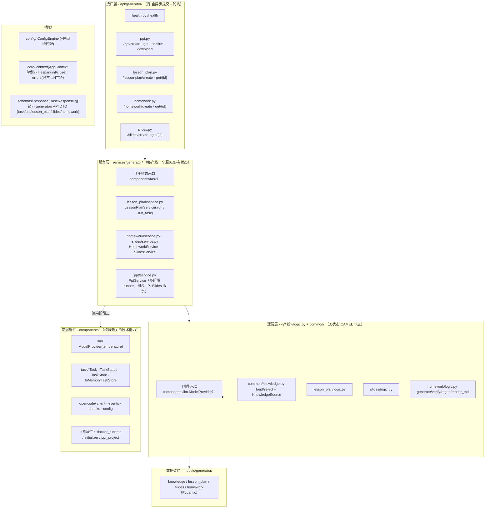
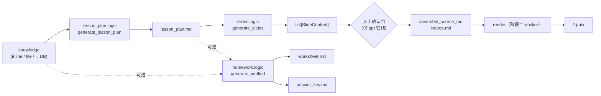
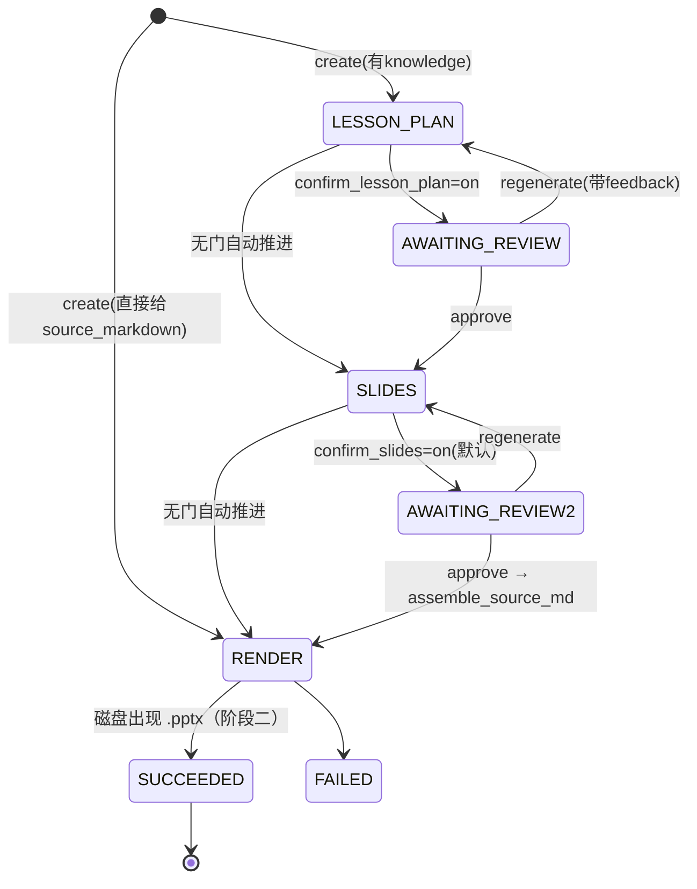

# 内容生成服务 · 架构文档

> 用 FastAPI 把「知识点 → 教案 / 作业 / PPT」三条产线包成 HTTP 服务。
> 参考实现在 `SHOU_Project/opencode_ppt/ocppt_app`（只作参考，不照搬）。
>
> 本文描述**当前已实现的架构（as-built）**。内容管线（教案/作业/slides + API + 任务态 + 错误处理）
> 已连真实模型验收通过；PPT 渲染（source.md → pptx，依赖 docker）为阶段二，暂留桩。

---

## 0. 已锁定的决策

| #  | 决策点            | 结论                                                                                                                                                                                                                                                                                                                                                                        |
| -- | ----------------- | --------------------------------------------------------------------------------------------------------------------------------------------------------------------------------------------------------------------------------------------------------------------------------------------------------------------------------------------------------------------------- |
| 1  | 内部枚举语言      | **全英文键**（`choice/fill_blank/subjective`、`basic/advanced/challenge`、`new_teach/review_comprehensive/unit_summary`）；prompt 要求模型输出英文键；给人看的 md 用 `TYPE_ZH`/`DIFF_ZH` 转中文                                                                                                                                                             |
| 2  | 教案/PPT/作业拓扑 | **分布为底 + 整合为薄编排**：每环节是独立自洽节点各出端点；PPT 全管线是薄状态机，只**组合调用**这些节点                                                                                                                                                                                                                                                         |
| 3  | 配置              | **收敛到 `ConfigEngine` 一套**：全项目走 `config_engine.base_config.xxx`；`Settings` 只作 env 读取源喂它                                                                                                                                                                                                                                                        |
| 4  | 代码组织          | **按产线切（feature-first）+ 每产线一个 Service 类**：`services/generator/<产线>/{logic.py, service.py}`；`service.py` = 一个服务类（`.run` + `.run_task`），依赖从**模块级 `AppContext` 单例**取（`self.context = context if context is not None else app_context`），`PptService` 组合其它服务；共享进 `common/`；`models/schemas/api` 按层 |
| 5  | 任务态            | **统一任务运行时**：四条产线全是 `Task`（`components/task/`）；单阶段产线（教案/作业/slides）+ 多阶段产线（ppt）跑在同一 `TaskStore` 上                                                                                                                                                                                                                         |
| 6  | 交互模式          | **全异步：提交→轮询**。每产线自己的端点：`POST /xxx/create`→`TaskRef`，`GET /xxx/get/{id}`→`TaskDetail`（不留同步入口，不用统一 `/tasks`）                                                                                                                                                                                                               |
| 6b | 响应形状          | **统一信封 `BaseResponse{code,msg,data}`**：**HTTP 恒 200**，真实状态码写进 body 的 `code`，业务数据一律放 `data`；接口层用 `ApiResult.data/ok/error` 构造，**不 raise `HTTPException`**（唯一例外：`GET /ppt/download/{id}` 成功时回二进制文件流）                                                                                           |
| 7  | 会变的边界        | `KnowledgeSource`（换 DB/云）、`TaskStore`（换 Redis）都是**接口**，本版最简实现，由全局 `AppContext` 持有（`initialize()` 里构建），替换只改一处                                                                                                                                                                                                             |
| 8  | 本版范围          | **内容管线全做**；**PPT 渲染（docker）留阶段二**                                                                                                                                                                                                                                                                                                                |

---

## 1. 宏观架构（分层）



**分层职责边界（铁律）**

- **api**：极薄。POST 一行 `return ApiResult.data(xxx_service.submit(req))`；GET 读全局 `context.task_store`。**不用 DI**，直接用模块级服务单例 + 全局 context。**一律返回 `BaseResponse` 信封，不 raise `HTTPException`**（404/409 用 `ApiResult.error(code, msg)` 返回）。不写业务逻辑。
- **services**：**每产线一个服务类**（依赖 provider/source 构造注入）。`run` 纯用例 + `run_task` runner（管任务态与异常兜底）；**调 logic 节点，不自己调 CAMEL**。`PptService` 组合其它服务。
- **logic**：无状态纯函数，`输入契约 → 输出契约`，内部调 CAMEL agent。可脱离 FastAPI 单测。
- **models**：纯数据契约（Pydantic / dataclass），**无行为、无 IO**。
- **components**：**与业务领域无关的技术能力 / 外部系统适配器**（换个领域也能原样复用）：
  `llm/`（LLM 适配）、`task/`（通用任务运行时）、`opencode/`（客户端）、阶段二 docker 运行时。
  判据：*"换个跟教学无关的领域，还会原样复用吗？"* 会 → components；不会 → `services/generator/common/`。
- **config / core / schemas**：横切设施。

---

## 2. 微观：三条产线的数据流与契约



**契约要点**

- 三条产线共享 `common/knowledge`（`load_knowledge` / `select_points` / `resolve_knowledge`）+ `components/llm`（`ModelProvider`）。
- **教案**：`LessonPlanRequest → LessonPlanResponse(lesson_plan_md)`。独立端点，也是 PPT 管线第 1 步。
- **slides**：`lesson_plan_md → list[SlideContent]`，再 `assemble_source_md` 成一页一节的 `source.md`（为阶段二锁死「一节一页不重排」）。
- **作业**：`HomeworkRequest → HomeworkResponse`，含 `generate → L1/L2 校验 → 重生成闭环`；输出结构化题目 + `worksheet.md` + `answer_key.md`。可选吃 `lesson_plan_md`。
- **注**：教案/slides/作业各自也可作为**独立异步任务**直接调用（不必走 ppt 管线）。

---

## 3. 通用任务运行时（所有产线共用）

`components/task/` 是产品无关的任务基建：

```
Task            task_id · kind · request · status · stage
                · context(runner 中间态) · result(最终产物) · review(确认门产物) · error · 时间戳
TaskStatus      pending / running / awaiting_review / succeeded / failed / cancelled
                （后三个是终态：`status.is_terminal`）
TaskStore(ABC)  create / get / list(kind?) / update / delete / spawn(task, coro) / cancel(task_id)
InMemoryTaskStore   进程内 dict + asyncio.create_task（+ cancel_all / wait_all 供关停与测试）
```

- **单阶段产线**（教案/作业/slides）：runner = 服务类的 `run_task` 方法，跑完把产物放 `result`、状态置 `SUCCEEDED`；出错落 `error` + `FAILED`。
- **多阶段产线**（ppt）：runner = `PptService`（状态机），用 `context` 存中间态（`lesson_plan_md`/`slides`/`source_markdown`）、`review` 给确认门、`stage` 记当前阶段。
- API 交互：`POST` 建任务 + `store.spawn(runner)` 后台推进 → 立即返回 `TaskRef`；`GET /{id}` 轮询取 `TaskDetail`（`SUCCEEDED` 时带 `result`）。
- 各产线返回自己的 `TaskDetail` 子类（`result` 类型不同），公共字段来自 `TaskDetailBase` + `base_detail_fields()`。

### 3.1 取消（`POST /<产线>/cancel/{id}`）

前端下停止信号即可中止某个特定任务。

**机制：`cancel()` 只做三件事，没有第四件**

```python
task = self._tasks.get(task_id)
if task is None or task.status.is_terminal: return False
self._cancel_bg(task_id)                        # ① asyncio.Task.cancel()
self.update(task, status=CANCELLED, ...)        # ② 同步改业务状态
return True
```

① **不是「杀死协程」，而是「往协程当前挂起的那个 `await` 点里扔一个 `CancelledError`」**。
协程从该 await 点原地抛异常，再像普通异常一样一路向上 unwind。
**`await` 点是唯一的可取消位置** —— 这是理解下面全部行为的钥匙。

② 业务状态是**同步**改的，所以调用方（前端轮询）立刻能查到 `cancelled`，
不必等协程真的停下来。因此 `cancel` 的语义是「**请求**取消」而非「保证已停」。

**取消的作用范围（实测结论）**

| 场景                                          | 结果                                                          |
| --------------------------------------------- | ------------------------------------------------------------- |
| 协程挂在 `await` 上（模型调用 / 网络 IO）     | **立即中断**，其后代码一行不执行                              |
| 内联 `await` 调下去的嵌套协程                 | **整条链一起 unwind**（`_run_lesson_plan_stage` → `_run_slides_stage` 即此形态） |
| 同一 store 里的**其它**任务                   | **不受影响**（一个业务 Task ↔ 一个 asyncio.Task）             |
| 协程还没被调度过一次（提交后立刻取消）        | 协程**一次都不执行**                                          |
| 正在跑一段**没有 `await`** 的代码             | **完全打不断**，见下                                          |

> 所以「取消」**不等于**「进行中的所有任务都被终止」，而是「那一个 asyncio.Task 及其整条 await 链被终止」。

**⚠️ 三个必须记住的坑**

1. **没有 `await` 的代码段打不断。** 纯计算，或 `time.sleep` / 同步 `requests` / 同步 docker SDK
   这类**阻塞调用**，单线程事件循环被它霸占着，连「受理你这个取消请求」都排不上队。
   实测：一段 ~0.9s 的阻塞代码，取消请求被拖了 0.94s 才生效，且该段代码**完整跑完**。

2. **`except BaseException` / 裸 `except:` 会把取消吞掉。** `CancelledError` 自 3.8 起继承
   `BaseException`，被吞后任务会「取消不掉」——状态是 `CANCELLED`，协程却继续跑完。
   我们的 runner **一律用 `except Exception`**，接不到 `CancelledError`，因此取消也不会被误记成 `FAILED`。
   逃逸出来的异常由 `_on_done` done-callback 兜底记日志（接住的是 **runner 自身的 bug**，
   否则 asyncio 只在 GC 时打一句 "Task exception was never retrieved"，极难定位）。

3. **停在确认门的任务没有活着的协程**（后台协程早已结束在等人），此时 `cancel` 只改状态；
   `PptService.confirm` 因 `status != AWAITING_REVIEW` 而拒绝续跑——取消才真正生效。

**边界与其它**

- `spawn(task, coro)` **必须带上业务 task**，store 才能维护 `task_id → asyncio.Task` 映射定位协程。
- 已是终态 → `cancel` 返回 `False`，端点回 code=409。
- **模型请求若已发出**：取消只是客户端断开连接，上游可能已在生成、甚至已计费——无法撤回，
  只保证不再等它的结果、不写进 `task.result`。
- `delete()` 会先掐掉在跑的协程；`AppContext.close()` 关停时对内存 store 调 `cancel_all()`
  （**换 RedisTaskStore 后不该这么做**——别的 worker 还在跑，故只对内存实现生效）。

**🔴 对阶段二（docker 渲染）的直接影响**

现在取消之所以干脆利落，是因为模型调用是**真异步 IO**。docker 渲染若写成同步阻塞调用
（`subprocess.run` / docker SDK 同步 API），就是上面坑 1 的情形：**取消完全无效，且整个事件循环被卡死，
所有其它请求一起挂起**。因此阶段二必须：

- 用 `asyncio.create_subprocess_exec`，或把阻塞调用丢 `run_in_executor`；
- 在 `except asyncio.CancelledError` / `finally` 里**显式清理容器**（kill + rm），否则容器会漏在那儿。

---

## 4. PPT 全管线状态机（多阶段 runner）



- 确认门 = `status=AWAITING_REVIEW` + `review` 产物 + `POST /ppt/confirm/{id}` 推进（opencode 无确认事件，确认必须在编排层做）。
- `PptService` 每个阶段方法**只调用被组合的产线服务**（`self._lesson_plan.run` / `self._slides.run` / `assemble_source_md`），中间态存 `task.context`，自身只管状态流转与异常兜底。
- **本版**：`RENDER` 阶段留桩——组装好 `source_markdown` 后标 `FAILED` 并说明（内容产物齐全，接 docker 即成），阶段二替换。

---

## 5. 模块布局（as-built file tree）

> **组织范式 = 按产线切（feature-first）**：每条产线是 `services/generator/<line>/` 下自包含包，
> `logic.py`（无状态节点）+ `service.py`（**一个服务类**：`.run` 纯用例 + `.run_task` runner）；共享进 `common/`。
> 数据契约 `models/`、API DTO `schemas/`、路由 `api/` 按层独立。

```
app/
  main.py                        # app + lifespan + include 聚合路由 + register_exception_handlers
  config/
    settings.py                  # env 读取 + _bypass_proxy_for（内网出站自动绕全局代理）
    cfg.py                       # ConfigEngine（唯一配置真相）
  core/
    context.py                   # AppContext（模块级单例 context）：config/model_provider/knowledge_source/task_store(+预留 redis)
    lifespan.py                  # 启动 context.initialize()，关停 close()
    errors.py                    # register_exception_handlers（领域异常 + openai → HTTP JSON）
  models/generator/              # 数据契约（纯 Pydantic/dataclass）
    knowledge.py lesson_plan.py slides.py homework.py
  services/generator/
    common/                      # 本领域跨产线共享（领域相关，故不进 components）
      knowledge.py               # load/select + KnowledgeSource(fetch) + resolve_knowledge
      errors.py                  # GenerationError / KnowledgeError / ParseError / ModelError
      service.py                 # BaseGenService（context 注入 + submit 一行：create+spawn+TaskRef）
    lesson_plan/
      logic.py                   # PROMPT + build_request + generate_lesson_plan（无状态节点）
      service.py                 # class LessonPlanService(BaseGenService) + 模块单例 lesson_plan_service
    slides/
      logic.py                   # PROMPT + generate_slides + assemble_source_md
      service.py                 # class SlidesService(.run / .run_task)
    homework/
      logic.py                   # PROMPT + generate/verify/regenerate/render_md（中文标签映射）
      service.py                 # class HomeworkService(.run / .run_task)
    ppt/
      service.py                 # class PptService（多阶段 runner；组合 LP+Slides 服务；渲染留桩）
  schemas/
    response.py                  # ★ 统一信封 BaseResponse[T] + ApiResult（全端点共用）
  schemas/generator/
    task.py                      # TaskRef / TaskDetailBase / base_detail_fields（TaskStatus 来自 components/task）
    lesson_plan.py               # GenRequest + Result + LessonPlanTaskDetail
    slides.py                    # GenRequest + Result + SlidesTaskDetail
    homework.py                  # GenRequest + Result + HomeworkTaskDetail
    ppt.py                       # CreateJobRequest / ConfirmRequest / PptStage / ReviewArtifact / PptTaskDetail
  api/generator/                 # 端点极薄：POST 一行 service.submit(req)；GET 读 context.task_store（无 Depends）
    __init__.py                  # 聚合 router
    health.py lesson_plan.py slides.py homework.py ppt.py
  components/                    # ★ 领域无关的技术能力（换个领域可原样复用）
    llm/provider.py              #   ModelProvider.get(temperature)（CAMEL 适配）
    task/models.py store.py      #   Task / TaskStatus / TaskStore / InMemoryTaskStore（通用任务运行时）
    opencode/                    #   client / events / chunks / config
    #（阶段二）docker_runtime.py initializer.py ppt_project.py（未搬）
```

**端点一览**

> 统一动词前缀风格：`/<产线>/create`（提交）、`/<产线>/get/{id}`（轮询）。
> **所有端点 HTTP 恒 200**，下表"作用"列里的 404/409 指信封 `code`，不是 HTTP 状态码。

| 方法+路径                                                  | 作用                                          |
| ---------------------------------------------------------- | --------------------------------------------- |
| `GET /health`                                            | 配置就绪 + 模型已装入                         |
| `POST /lesson-plan/create` `GET /lesson-plan/get/{id}` | 教案：提交→轮询                              |
| `POST /slides/create` `GET /slides/get/{id}`           | 逐页 slides + source.md                       |
| `POST /homework/create` `GET /homework/get/{id}`       | 作业（含 L1/L2 校验闭环）                     |
| `POST /ppt/create`                                       | PPT 全管线：建任务                            |
| `GET /ppt/list` `GET /ppt/get/{id}`                    | 列表 / 查详情（status/stage/review）          |
| `POST /ppt/confirm/{id}`                                 | 确认门推进（approve / regenerate）            |
| `GET /ppt/download/{id}`                                 | 下载 pptx（成功=二进制流；阶段二前 code=409） |
| `DELETE /ppt/delete/{id}`                                | 删除任务（回`ApiResult.ok`）                |

---

## 6. 关键约定

### 6.0 服务类 + 全局 AppContext + 一行 submit

- 每条产线一个服务类：`LessonPlanService` / `SlidesService` / `HomeworkService` / `PptService`。
  三个单阶段的继承 `common/service.py` 的 **`BaseGenService`**；每个 service 模块底部导出**模块级单例**
  （`lesson_plan_service` / `slides_service` / `homework_service` / `ppt_service`），接口层直接用。
- **依赖走全局 AppContext**：`__init__(self, context=None): self.context = context if context is not None else app_context`
  （`app_context` = 模块级单例）；服务用 `self.context.model_provider` / `self.context.knowledge_source`。
- **一行 submit（接口层用）**：`BaseGenService.submit(request)->TaskRef` 收敛「建任务→`spawn(run_task)`→返回 TaskRef」
  三步；端点即 `return xxx_service.submit(req)`。`PptService.submit` 另含「按入口选起始阶段」逻辑。
- **契约强制**：`BaseGenService(ABC)`，`run_task` 标 `@abstractmethod`——漏实现在**实例化时**就
  `TypeError`（模块级单例使其 import 即暴露），而不是等后台任务跑起来抛 `NotImplementedError`
  被 runner 吞进 `task.error`（编码错误伪装成运行时任务失败）。`KIND` 由 `__init_subclass__` 校验，
  漏设在**类定义时**报错（否则 kind 为空串，GET 时 kind 对不上而 404，属难查的静默 bug）。
- **两类方法**：`run(...)` 纯用例（返回结果，可复用、可脱离 FastAPI 单测）；
  `run_task(task, store)` runner（管任务态流转 + 异常兜进 `task.error`）。
- **`PptService` 组合其它服务**：`__init__(context=None, *, lesson_plan=None, slides=None)`，
  默认从同一 context 建子服务，阶段方法调 `self._lesson_plan.run` / `self._slides.run`，不重复实现。
- **不用依赖注入**：端点不写 `Depends`，直接用模块级服务单例 + 全局 `context`（已删 `app/dependencies.py`）。
- **测试**：fixture 里 `context.initialize()` + 换 `context._task_store` 为干净 `InMemoryTaskStore`；
  `monkeypatch` router 模块级 service 单例为假服务（真类子类 `super().__init__()` 用全局 context、只 override `run`）。
  PptService 单测直接构造并注入假子服务 + 假 context。

### AppContext（全局上下文 · `app/core/context.py`）

- **模块级单例**：`context.py` 底部实例化一次 `context = AppContext()`，各处 `from app.core.context import context`
  共用同一个。用普通类（不用 metaclass），类型推断干净、IDE 有补全。
- 持有共享中间件/客户端：`config` / `model_provider` / `knowledge_source` / `task_store`（+ 预留 `redis` 等）。
- 生命周期：lifespan 启动调 `context.initialize()`（幂等构建），关停调 `await context.close()`。
- 替换了原先「挂 `app.state` + 逐层 `Depends`」的做法。服务默认用模块 `context`，测试可传自定义 context。

### 6.0b 统一响应信封（`schemas/response.py`）

```python
class BaseResponse[T](BaseModel):
    code: int          # 业务状态码（200/404/409/422/502…）
    msg: str           # 可读文案
    data: T | None     # 所有业务数据一律放这里
```

- **HTTP 状态码恒为 200**，真实状态码在 body 的 `code` —— 客户端只解析一种形状，不必分支处理。
- 接口层三个构造器（`ApiResult`）：`data(payload)` 带数据成功、`ok(msg)` 无数据成功、`error(code, msg)` 报错。
- **接口层不 raise `HTTPException`**：404/409 这类可预期分支直接 `return ApiResult.error(...)`。
- 声明 `response_model=BaseResponse[TaskRef]` 之类，OpenAPI 里 `data` 的类型仍然精确（PEP 695 泛型 + pydantic 2.12 可用）。
- 未被端点接住的异常由 `core/errors.py` 的 handler 兜成同一信封（领域异常 / openai `APIError` / 422 校验）。
- **唯一例外**：`GET /ppt/download/{id}` 成功时必须回二进制 `FileResponse`（套不进 JSON 信封），
  故标 `response_model=None`、返回类型 `FileResponse | BaseResponse[Any]`；**失败路径仍回信封**。
- 测试帮手在 `tests/conftest.py`：`unwrap(r, code=200)` 取 `data`，`err_msg(r, code)` 断言错误码并取 `msg`。

### 6.1 英文枚举 ↔ 中文展示的边界

- **内部**：`Question.type ∈ {choice, fill_blank, subjective}`；`Difficulty ∈ {basic, advanced, challenge}`；`plan_mode ∈ {new_teach, review_comprehensive, unit_summary}`。
- **prompt**：system prompt 显式规定模型输出英文键（枚举表 + 英文示例 JSON），杜绝解析失败。
- **展示**：`render_worksheet / render_answer_key` 用 `TYPE_ZH` / `DIFF_ZH` 映射表转中文。
- schema 的 `plan_mode` 与 `models/lesson_plan.SessionParams` 一致（均英文 Literal）。

### 6.2 配置（单一真相 = ConfigEngine）

- 只从 `config_engine.base_config.*` 取配置；`Settings` 只是 env 读取源。
- **内网绕代理**：`settings._bypass_proxy_for` 在加载时把模型/opencode 主机并入 `NO_PROXY`，
  避免开发机全局 socks 代理拦截内网端点（表现为 503）。跑 app/脚本都自动生效。

### 6.3 模型注入（AppContext + 保留 temperature）

- `AppContext.initialize()` 建 `ModelProvider`（持 LLM 配置，内部按温度缓存），存入 `AppContext`。
- 服务经 `self.context.model_provider` 取用。
- logic 节点吃「模型」参数；service 从 provider 取对应温度（教案 0.1 / slides 0.2 / 作业 0.2 / 校验 0.1）。

### 6.4 任务态与错误处理（异步模型）

- **提交→轮询**：`POST /xxx` **立即返回** `TaskRef`，`store.spawn(runner)` 后台推进；`GET /xxx/{id}` 轮询。
- **错误落 `task.error`**：异步任务没有正在等待的请求可冒泡，runner 用 `except` 把异常兜进
  `task.error`（`"{类型}: {消息}"`），客户端轮询看到 `status=failed` + 原因。
- **领域异常**（`common/errors.py`）：`KnowledgeError`(400) / `ParseError`(502) / `ModelError`(502)，
  就近 raise，语义清晰；runner 靠它把错误分类进 `task.error`。
- **HTTP handler**（`core/errors.py`）：领域异常 + openai `APIError` + 请求校验错误 → **统一信封**
  （`envelope(code, msg)`：HTTP 200 + body `code`）。异步化后主要覆盖**同步路径**：请求体校验（422）。
  ppt confirm 冲突（409）由端点自己 `ApiResult.error` 返回。
- **何时才加 try/except**：只在能「翻译外来异常 / 恢复重试 / 捕获状态」时加（如 `FileKnowledgeSource`
  翻 `FileNotFoundError→KnowledgeError`、homework `verify→regenerate` 闭环、runner 捕获进 `task.error`）；
  透传型 try/except 是噪音。

### 6.5 会变的边界都放接口

- **`KnowledgeSource`（`common/knowledge.py`）**：`fetch(ref) -> dict`。本版 `FileKnowledgeSource`（ref=文件路径）+ inline 直通（`resolve_knowledge`）。将来 `DBKnowledgeSource`/`CloudKnowledgeSource`，logic 只吃解析后 dict。
- **`TaskStore`（`components/task/`）**：`create/get/list/update/delete/spawn/cancel`。本版 `InMemoryTaskStore`。将来 `RedisTaskStore`；⚠️ 多进程/多 worker 时 `spawn` 不能再用进程内 `create_task`，需接任务队列（arq/celery/dramatiq）——换实现，接口不变。`cancel` 届时用「取消标志位 + worker 轮询」实现同一语义（本版是 `asyncio.Task.cancel()`）。
- 两者都收在全局 `AppContext`（`initialize()` 里构建）；服务经 `self.context.xxx` 取用，切换实现只改 `AppContext.initialize()` 一处。

---

## 7. 进度与验收

**已完成（连真实模型验收通过）**

- ✅ 配置收敛 + DI 基座（`ConfigEngine` / `ModelProvider` / lifespan / dependencies）+ 内网绕代理。
- ✅ `common/`（camel_model / knowledge / task / errors）+ 三产线 `logic.py`（英文枚举 prompt）。
- ✅ 每产线一个服务类（`LessonPlanService`/`SlidesService`/`HomeworkService`/`PptService`，`.run` + `.run_task`，`PptService` 组合其它服务）。
- ✅ 统一任务运行时：四产线全跑在 `components/task/` 的 `Task`/`TaskStore` 上。
- ✅ 全局 `AppContext`（模块级单例 `context`，普通类）持共享中间件（config/model_provider/knowledge_source/task_store，+预留 redis）；替换 app.state + 逐层 Depends。
- ✅ api 全接线：健康 + 四产线端点，统一 `/create`、`/get/{id}` 风格；统一错误处理。
- ✅ **测试体系（144 用例 / 覆盖率 99%）**：见 §8。真机 `POST /lesson-plan/create` submit→poll
  端到端跑通（读文件知识源 → 教案 markdown）。
- ✅ 质量门禁：`ruff` 全绿、`pyright`（standard，53 文件）0 errors、`pytest --cov-fail-under=95`。

**剩余 · 阶段二（渲染）**

- 搬 `components/opencode/{docker_runtime, initializer, ppt_project}.py`。
- `pipeline.run_render` 桩换成真实 docker 渲染（起容器 → 确定性初始化 → `run_until` 以「磁盘出现 .pptx」为判据 → `chown` → 落 `PptResult`）。
- `/ppt/download/{id}` 出 pptx。
- ⚠️ **渲染必须写成非阻塞**（`asyncio.create_subprocess_exec` 或 `run_in_executor`），否则任务取消失效
  且事件循环被卡死；并在 `except CancelledError`/`finally` 里清理容器。详见 §3.1 末尾。

**其它待议**

- 任务持久化：`InMemoryTaskStore` 重启即丢；上生产换 `RedisTaskStore` + 任务队列（接口已就位）。
- slides 重新分页风险：阶段二渲染时 skill 的 Strategist 会按体量重排页，需 `source.md` 显式一节一页 + 渲染 prompt 锁死（见参考 `PROJECT_GUIDE.md` §4）。
- CAMEL 对自定义模型名报 `Unknown model … context window` 警告（无害，可选消除）。

```

```

---

## 8. 测试体系

**分层与打桩边界**（关键：不同层挡在不同位置）

| 目录                   | 挡在哪                                     | 覆盖什么                                                                                                                                    |
| ---------------------- | ------------------------------------------ | ------------------------------------------------------------------------------------------------------------------------------------------- |
| `tests/unit/`        | 完全不碰模型/FastAPI                       | 纯函数与契约：选点排序、分值回填、L2 检索、掩码/答案、markdown 渲染、任务存储 CRUD、schema 校验器、`BaseGenService` 契约、异常→HTTP 映射 |
| `tests/integration/` | **只换掉 `ChatAgent`（模型调用）** | api→service→logic→JSON 解析→渲染→任务态**全链路真跑**                                                                            |

> ⚠️ 早期 `test_api_wiring.py` 在**服务层**打桩（override `run`），会把业务逻辑整个跳过——
> 那只能算"接线测试"。真正的集成测试必须把打桩边界下移到模型调用（`conftest.FakeChatAgent`），
> 否则覆盖率是虚的（曾经 `homework/logic.py` 只有 21%）。

**共享 fixtures**（`tests/conftest.py`）

- `knowledge` —— 两个知识点的最小样例（含"多余字段"用于验证 `_clean` 过滤）。
- `fake_agent` —— 把三条产线 logic 里的 `ChatAgent` 换成假的，支持 `replies` 队列 / `default` /
  `empty`（模拟空响应），并记录 `seen_system_messages` / `seen_prompts` 以断言"选对了 prompt"。
- `task_store` —— 给全局 `context` 换一份干净的 `InMemoryTaskStore`，用完还原（测试间隔离）。

**重点保障的行为**

- **英文枚举契约**：模型吐中文键（`"选择"`/`"进阶"`）必须解析失败 → `ParseError`（这是该约定的保护网）。
- **确定性回填**：分值/总分由程序按参数回填，不信模型；`index` 重排成连续 1..N。
- **确认门**：人工改稿后组装 `source.md` 必须用改后的内容；regenerate 真的再调一次模型。
- **错误分流**：`ParseError`/`ModelError`/`KnowledgeError` 落进 `task.error`（异步任务无请求可冒泡）；
  同步路径由 `core/errors.py` 的 handler 映射成 4xx/5xx。
- **kind 隔离**：拿别的产线的 `task_id` 访问必须 404，不能串号。

**门禁**：`pytest`（含 `--cov-fail-under=95`）+ `ruff` + `pyright`（standard）。
未覆盖的 7 行是 `__main__` 守卫、openai `ImportError` 兜底、config env 回退等不可达/无价值分支。
